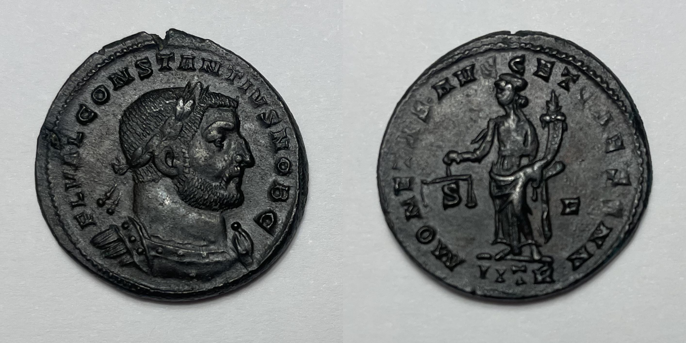

# coinimg

Concatenate obverse and reverse photos of a coin on a white background into a single 50/50 image.



## Using

```python
from coinimg import concatenate

pair = concatenate("obverse.heic", "reverse.heic", margin=0.08, rotate=90)
pair.save("pair.jpg")
```

`concatenate` finds each coin from its closed outline using brightness and color edges, crops a square around its center using the max radius (chips and oblong flans included), scales both faces to the same size, and joins them horizontally. It handles coins lighter or darker than the paper and rejects large frame-touching shadows.

Inputs should contain one fully visible, roughly circular coin with a discernible rim on a plain background. Multiple round objects, a rim merging into a shadow, or an extremely low-contrast/blurred rim can still confuse detection. If no suitable outline is found, detection raises `ValueError` rather than cropping the background.

Rotations are clockwise degrees: `0`, `90`, `180`, or `270`. Inputs can be HEIC or any format Pillow can open.

## Disclaimer

This project is vibecoded. While it is probably higher quality than my hand-written code, use at your own peril.